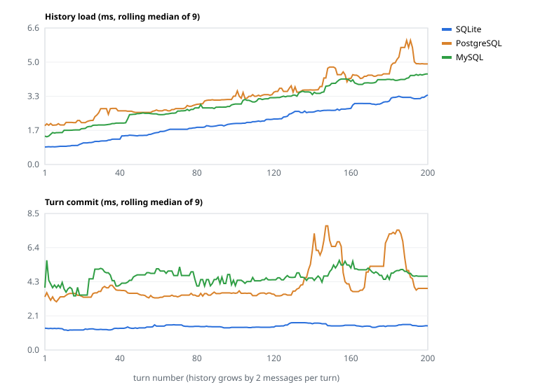

# v0.2 端到端测试与三库对比

运行：`20261110-202340`，生成于 2026-11-10 20:24。方法见[测试计划](../../plans/v0.2-e2e-test-plan.md)；本文由 `dev/e2e/report.py` 生成，请勿手改。

环境：macOS 26.5.2，Python 3.12.13；SQLite 3.53.1，PostgreSQL 18.6，MySQL 8.0.46。PostgreSQL 与 MySQL 运行在 Docker 中，SQLite 为本地文件。所有模型调用由确定性假模型应答。

## 结论

- **SQLite**：用例 8/8 通过；库内一致性检查全部满足。
- **PostgreSQL**：用例 8/8 通过；库内一致性检查全部满足。
- **MySQL**：用例 8/8 通过；库内一致性检查全部满足。
- 三库存储内容完全一致：比对了 9 个会话、426 条消息（含中途停止的会话只比对消息结构）。

## 用例结果

| 用例 | SQLite | PostgreSQL | MySQL |
|---|---|---|---|
| 1. basic multi-turn + SSE replay | ✅ 18/18 | ✅ 18/18 | ✅ 18/18 |
| 2. Unicode + 100 KiB answer | ✅ 8/8 | ✅ 8/8 | ✅ 8/8 |
| 3. tool call | ✅ 9/9 | ✅ 9/9 | ✅ 9/9 |
| 4. stop mid-reply | ✅ 7/7 | ✅ 7/7 | ✅ 7/7 |
| 5. restart + CLI --resume | ✅ 14/14 | ✅ 14/14 | ✅ 14/14 |
| 6. two sessions at once + 409 | ✅ 13/13 | ✅ 13/13 | ✅ 13/13 |
| 7. rename + delete | ✅ 9/9 | ✅ 9/9 | ✅ 9/9 |
| 8. CLI write, gateway read | ✅ 4/4 | ✅ 4/4 | ✅ 4/4 |

## 各阶段耗时（毫秒）

服务端在 Gateway 进程内计时（`dev/e2e/serve_gateway.py`）；客户端时间含本机 HTTP。统计范围是该库的全部轮次（用例加增长曲线）。

| 阶段 | SQLite p50 / p95 / max | PostgreSQL p50 / p95 / max | MySQL p50 / p95 / max |
|---|---|---|---|
| 加载历史 `load_history` | 1.99 / 3.34 / 4.67 | 3.32 / 6.67 / 8.67 | 3.05 / 4.85 / 9.19 |
| 落库 `commit_turn` | 1.49 / 2.11 / 4.41 | 3.69 / 7.76 / 19.4 | 4.64 / 7.99 / 34.7 |
| Agent 运行（含假模型） | 13.6 / 24.8 / 2051.1 | 14.1 / 24.8 / 2057.3 | 14.1 / 25.0 / 2057.7 |
| 首字延迟 | 13.0 / 24.1 / 54.4 | 13.6 / 24.0 / 54.9 | 13.5 / 24.3 / 54.5 |
| 客户端：发起 run | 1.02 / 1.36 / 1.75 | 2.16 / 3.89 / 6.19 | 1.66 / 2.33 / 11.4 |
| 客户端：发起到终态 | 21.2 / 34.8 / 40.6 | 27.1 / 44.2 / 49.7 | 27.3 / 42.1 / 58.4 |

其他存储操作 p50（毫秒，次数）：

| 操作 | SQLite | PostgreSQL | MySQL |
|---|---|---|---|
| `create_session` | 1.20（9） | 2.33（9） | 4.85（9） |
| `delete_session` | 0.93（1） | 5.05（1） | 4.54（1） |
| `get_session` | 0.60（238） | 1.70（238） | 1.20（238） |
| `list_sessions` | 1.12（3） | 6.02（3） | 3.21（3） |
| `read_messages` | 1.05（22） | 2.54（22） | 2.23（22） |
| `rename_session` | 1.27（2） | 5.73（2） | 4.62（2） |

## 历史增长曲线

同一会话连续对话，每轮新增 2 条消息。图中为 9 轮滚动中位数，表中为该轮的单次值；`读全部` 为分页读取全部消息的总耗时（客户端）。



| 轮次 | 历史条数 | SQLite 加载 / 落库 / 读全部 | PostgreSQL 加载 / 落库 / 读全部 | MySQL 加载 / 落库 / 读全部 |
|---|---|---|---|---|
| 1 | 0 | 0.85 / 1.36 / 1.63 | 1.88 / 3.32 / 5.23 | 1.38 / 3.89 / 2.95 |
| 10 | 18 | 0.86 / 1.33 / 1.99 | 1.86 / 3.96 / 3.86 | 1.55 / 4.68 / 3.08 |
| 25 | 48 | 1.15 / 1.36 / – | 2.79 / 3.66 / – | 1.93 / 3.92 / – |
| 50 | 98 | 1.46 / 1.62 / 2.99 | 2.53 / 3.40 / 5.16 | 2.51 / 4.40 / 6.34 |
| 75 | 148 | 1.81 / 1.61 / – | 2.87 / 3.25 / – | 4.31 / 4.90 / – |
| 100 | 198 | 2.01 / 1.38 / 5.61 | 3.13 / 3.54 / 10.6 | 3.16 / 3.87 / 8.62 |
| 125 | 248 | 2.58 / 1.70 / – | 3.51 / 3.81 / – | 3.32 / 4.82 / – |
| 150 | 298 | 2.62 / 1.50 / – | 3.86 / 3.47 / – | 4.15 / 5.03 / – |
| 175 | 348 | 3.05 / 1.50 / – | 4.21 / 6.96 / – | 4.48 / 4.28 / – |
| 200 | 398 | 3.38 / 1.51 / 11.7 | 6.75 / 7.59 / 31.6 | 4.41 / 5.42 / 19.9 |

## 存储空间

| 后端 | 会话 | 消息 | 消息 payload | 表占用 | 占用 / payload |
|---|---|---|---|---|---|
| SQLite | 9 | 426 | 401 KiB | 556 KiB | 1.39 |
| PostgreSQL | 9 | 426 | 401 KiB | 512 KiB | 1.28 |
| MySQL | 9 | 426 | 401 KiB | 656 KiB | 1.64 |

SQLite 为数据库文件页数乘页大小；PostgreSQL 为 `pg_total_relation_size`（含索引与 TOAST）；MySQL 为 `ANALYZE TABLE` 后 `information_schema` 的数据与索引长度，以 16 KiB 页为单位，粒度较粗。

## 内容一致性

每条消息以存储的 payload 计算 SHA-256，按会话标题对齐后逐条比对。

- 无差异。

## 局限

- PostgreSQL、MySQL 在 macOS 的 Docker 虚拟机中运行，每次访问经过虚拟网络；SQLite 在进程内读写文件。数字反映本机开发环境，不代表生产部署。
- 假模型不验证真实模型的回答与流式行为；真实模型的功能验收另行进行。
- 单次运行，未做多次重复取平均；少于几毫秒的差异可能来自调度抖动。

## 复现

```bash
docker compose -f dev/databases/compose.yaml up -d --wait postgres mysql
uv run python dev/e2e/run_cases.py
```

原始数据（每个事件的 JSONL、服务端 trace、汇总 JSON）位于被 git 忽略的 `dev/e2e/results/20261110-202340/`。
